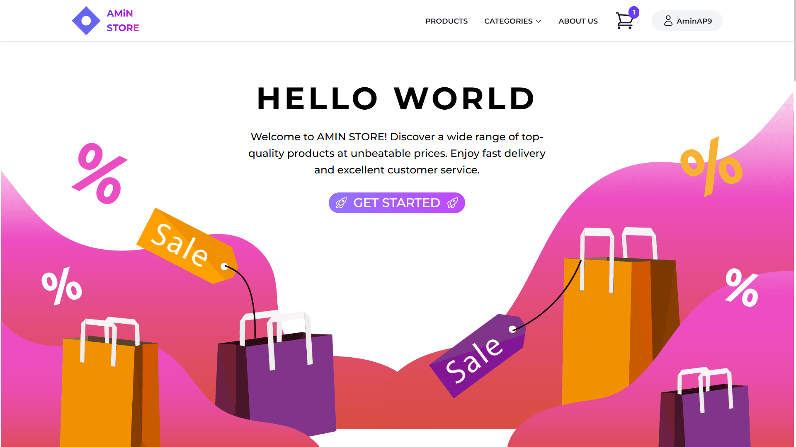
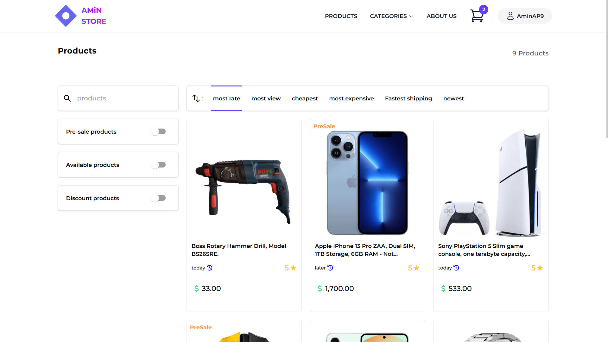
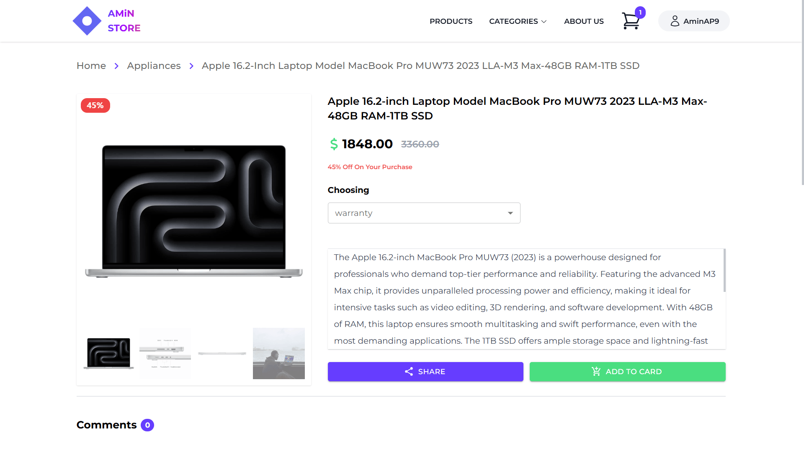
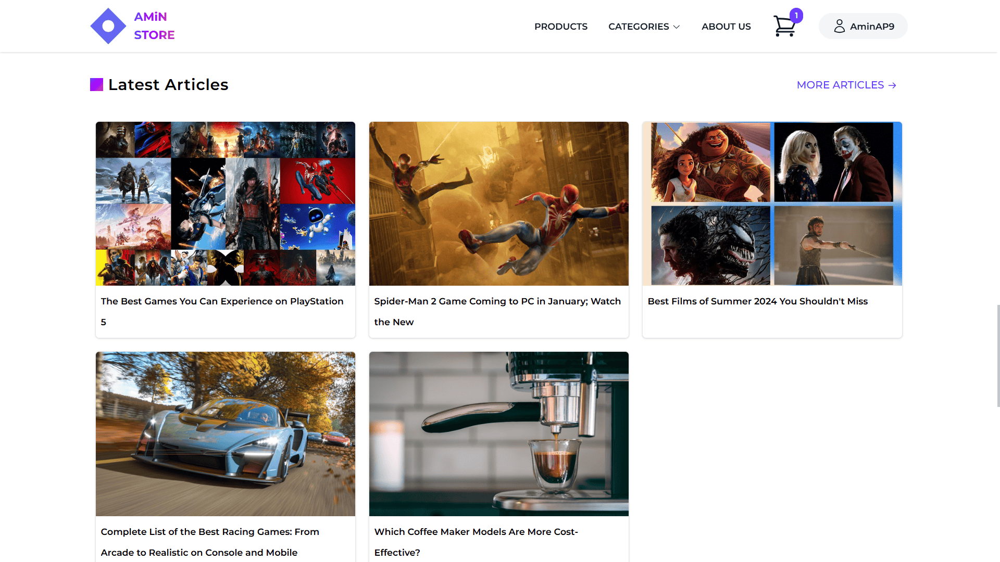
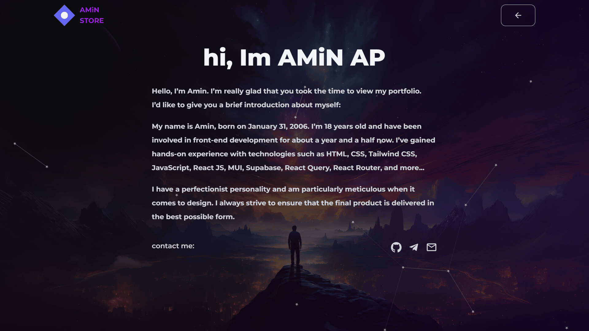
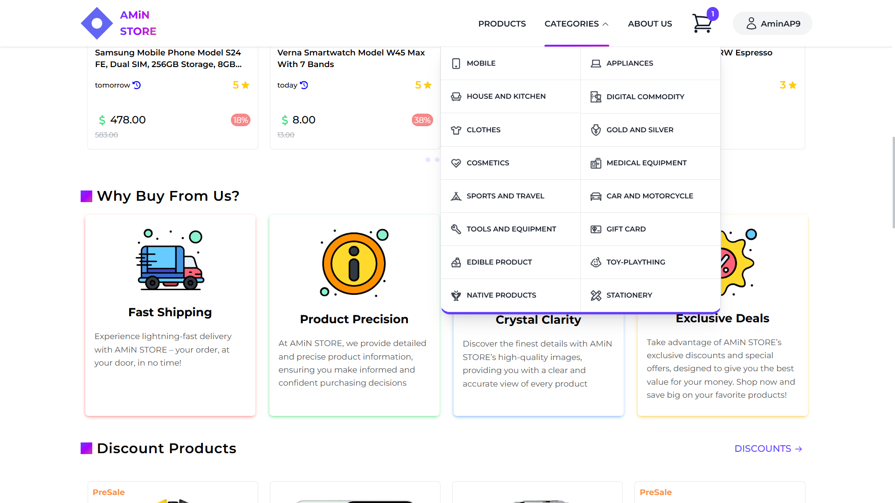
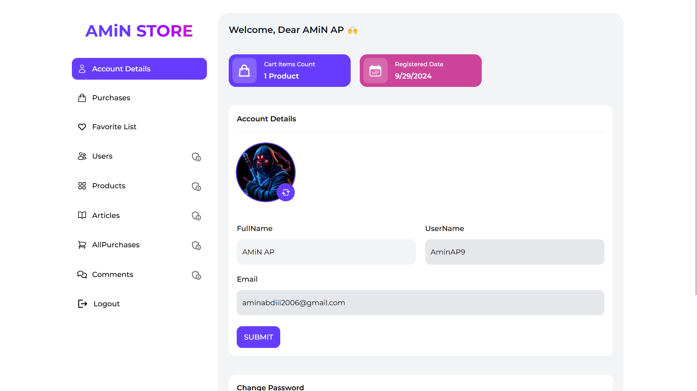
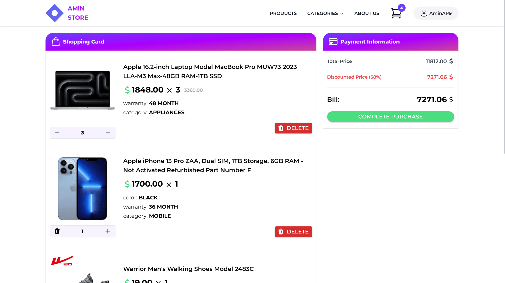

<h1 align="center"><a href="https://amin-store-xi.vercel.app">AMiN STORE 🔗</a></h1>

### Backend connection

Copy `.env.example` to `.env.local` and set `VITE_API_BASE_URL` to the REST API root, including `/api/v1`. The local default is `http://localhost:3001/api/v1`; `VITE_API_TIMEOUT_MS` defaults to `8000` milliseconds. Restart Vite after changing environment files, and rebuild when changing deployment settings because Vite embeds public variables at build time.

The backend's `CORS_ORIGINS` must allow the frontend origin (normally `http://localhost:5173`). Image URLs come from API responses and the backend's media configuration. No database credentials, signing keys, or administrator secrets belong in frontend environment variables. Existing sessions require signing in again after switching to this API.

`npm test` runs offline tests with mocked network requests. `npm run build` checks the production bundle.

### Developed with Vite & React. Project overview 👇

This template provides a minimal setup to get React working in Vite with HMR and some ESLint rules.

Currently, two official plugins are available:

- [@vitejs/plugin-react](https://github.com/vitejs/vite-plugin-react/blob/main/packages/plugin-react/README.md) uses [Babel](https://babeljs.io/) for Fast Refresh
- [@vitejs/plugin-react-swc](https://github.com/vitejs/vite-plugin-react-swc) uses [SWC](https://swc.rs/) for Fast Refresh

